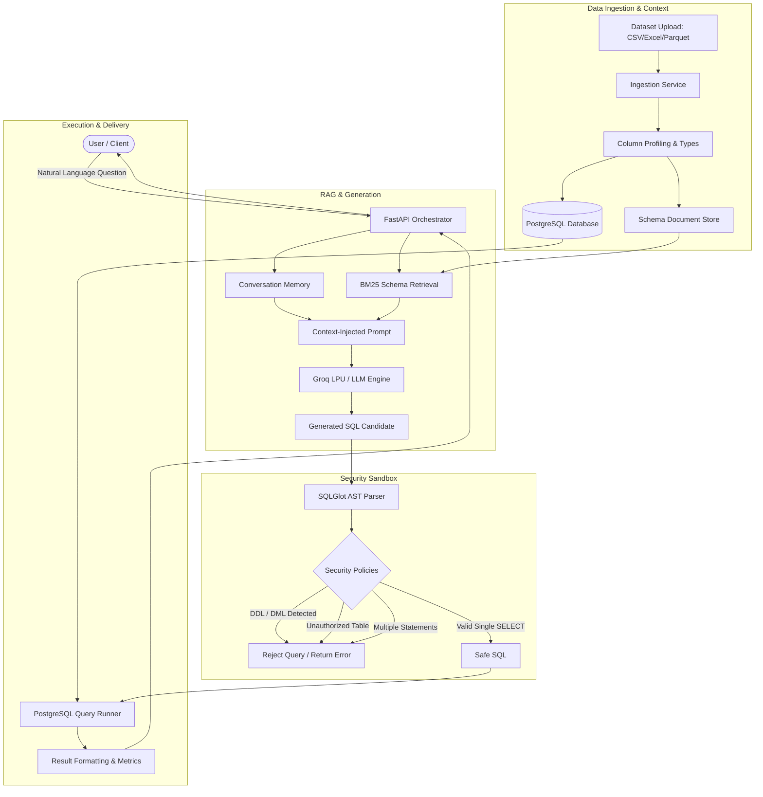

# InsightSQL 🔍

> **High-Performance, AST-Guarded Natural Language to SQL Analytics Engine**

[](https://www.python.org/)
[](https://fastapi.tiangolo.com/)
[](https://www.postgresql.org/)
[](https://groq.com/)
[](https://github.com/tobymao/sqlglot)
[](https://www.docker.com/)

InsightSQL is an enterprise-grade conversational data analytics engine that translates complex natural language business questions into precise, executable PostgreSQL queries. Designed with a **security-first philosophy**, it couples low-latency LLM inference (powered by Groq) with strict Abstract Syntax Tree (AST) validation to guarantee read-only database safety and eliminate SQL injection risks.

---

## 🌟 Key Features

- **⚡ Sub-Second Query Synthesis**: Integrates Groq LPU inference for ultra-fast, low-latency SQL code generation with deterministic JSON output schemas.
- **🛡️ AST-Level Security Sandbox**: Evaluates all generated queries using `sqlglot` to enforce single-`SELECT` statements, reject destructive DDL/DML, block system schemas (`pg_catalog`, `information_schema`), and restrict queries to authorized table allowlists.
- **📚 Schema-Aware Retrieval (RAG)**: Indexes table schemas, data types, null profiles, and business definitions using a BM25 lexical ranking engine to ground LLM prompts with exact catalog context.
- **💬 Conversational Memory & Multi-Turn Context**: Maintains conversational state across dialogue turns, resolving contextual follow-ups (*e.g., "Now filter for Bangalore"*) and tracking query lineage.
- **📊 Automated Dataset Ingestion**: Ingests CSV, Excel, Parquet, and JSON datasets with automatic data type inference, column statistics profiling, and schema generation.
- **⏱️ Bounded Execution Engine**: Implements strict query timeouts (5000ms), result pagination/row caps, and isolated database sessions to safeguard database stability.
- **🧪 12-Scenario Verification Suite**: Includes comprehensive automated test suites benchmarking aggregations, rankings, filters, multi-turn contexts, and destructive injection attacks.

---

## 🏗️ Architecture



---

## 🛡️ Security & Guardrails

InsightSQL prevents untrusted code execution using defense-in-depth security policies:

| Layer | Policy | Enforcement Mechanism |
| :--- | :--- | :--- |
| **AST Validation** | Read-Only Enforcement | `sqlglot` parses queries into an Abstract Syntax Tree, rejecting any statement that is not a solitary `SELECT`. |
| **Isolation** | Table Allowlists | Restricts queries solely to the tables associated with the active dataset. |
| **System Protection**| System Schema Block | Explicitly denies access to `pg_catalog`, `pg_temp`, and `information_schema`. |
| **Injection Defense**| Statement Boundary | Blocks semicolon-chained multi-statements (`SELECT ...; DROP TABLE ...`). |
| **Resource Limits** | Statement Timeout | Configures PostgreSQL session-level timeouts (`SET statement_timeout = 5000`) and limits return rows. 

---

## 🛠️ Tech Stack

- **Backend Framework**: Python 3.12+, FastAPI, Uvicorn, Pydantic v2
- **Database & ORM**: PostgreSQL 16, SQLAlchemy 2.0, Psycopg 3
- **LLM Inference**: Groq API (Ultra-low latency inference via open-weights models) / OpenAI fallback
- **SQL Parser & Security**: `sqlglot`, `sqlparse`
- **Data Ingestion**: Pandas, PyArrow, OpenPyXL
- **Frontend** *(Optional UI)*: React 19, TypeScript, Tailwind CSS v4, Vite, Lucide Icons
- **Infrastructure & Testing**: Docker, Docker Compose, Pytest, HTTPX

---

## 🚀 Quickstart

### Prerequisites
- [Docker](https://www.docker.com/) & Docker Compose **OR** Python 3.12+ with PostgreSQL installed locally.
- Groq API Key (or OpenAI API Key).

---

### Option 1: Run with Docker Compose (Recommended)

1. **Clone the repository:**
   ```bash
   git clone https://github.com/pradeepv777/InsightSQL.git
   cd InsightSQL
   ```

2. **Configure environment:**
   ```bash
   cp .env.example .env
   ```
   Open `.env` and set your Groq or OpenAI API key.

3. **Start the containers:**
   ```bash
   docker compose up --build
   ```

   - **Backend API**: `http://localhost:8000`
   - **Interactive API Docs**: `http://localhost:8000/docs`

---

### Option 2: Local Development Setup

#### 1. Database Setup
Ensure PostgreSQL is running locally and create a database named `ai_analyst`:
```sql
CREATE DATABASE ai_analyst;
```

#### 2. Backend Setup
```bash
cd backend

# Create and activate virtual environment
python -m venv venv
source venv/bin/activate  # On Windows: venv\Scripts\activate

# Install dependencies
pip install -r requirements.txt

# Start FastAPI server
uvicorn app.main:app --reload --port 8000
```

#### 3. Frontend Setup (Optional)
```bash
cd frontend
npm install
npm run dev
```
Access the web client at `http://localhost:5173`.

---

## 🧪 Testing & Evaluation

InsightSQL includes a comprehensive evaluation and regression suite validating query generation correctness, AST security, and conversational context:

```bash
cd backend
python -m pytest tests/ -v
```

### Test Suite Highlights:
- `test_sql_policy.py`: Verifies AST detection of destructive statements (`DROP`, `DELETE`, `UPDATE`), multi-statement injection, and system schema tampering.
- `test_ingestion.py`: Validates schema type inference, null-rate profiling, and data ingestion limits across file formats.
- `test_evaluation.py`: Evaluates analytical benchmark scenarios across aggregations (`AVG`, `SUM`), filters (`WHERE`), ranking (`TOP K`), duplicates, and null counts.
- `test_hr_questions.py`: Tests domain-specific business queries and multi-turn conversational follow-up resolution.

---

## 📂 Project Structure

```text
InsightSQL/
├── backend/
│   ├── app/
│   │   ├── api/v1/endpoints/ # API routes (datasets, conversations, health)
│   │   ├── core/             # Database connection, settings, configuration
│   │   ├── models/           # SQLAlchemy database models & schemas
│   │   ├── schemas/          # Pydantic validation schemas
│   │   └── services/
│   │       ├── ingestion.py  # File parsing & database table creation
│   │       ├── orchestrator.py # Multi-turn conversational controller
│   │       ├── rag.py        # BM25 schema & catalog retrieval
│   │       ├── sql_generator.py # Groq LLM integration & prompt formatting
│   │       └── sql_policy.py # SQLGlot AST validation & security guards
│   ├── tests/                # Automated pytest evaluation suite
│   ├── Dockerfile
│   └── requirements.txt
├── frontend/                 # React 19 + TypeScript + Tailwind CSS UI
├── docker-compose.yml        # Multi-container orchestration
└── README.md
```

---

## 📜 License

This project is licensed under the [MIT License](LICENSE).
